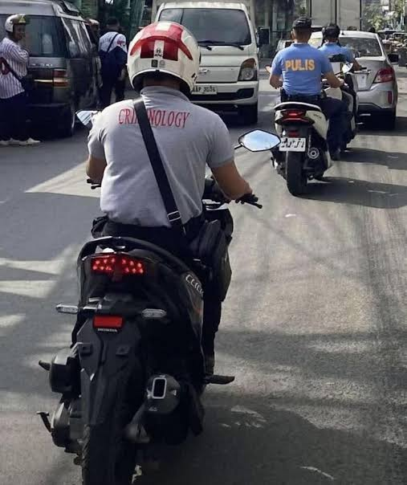
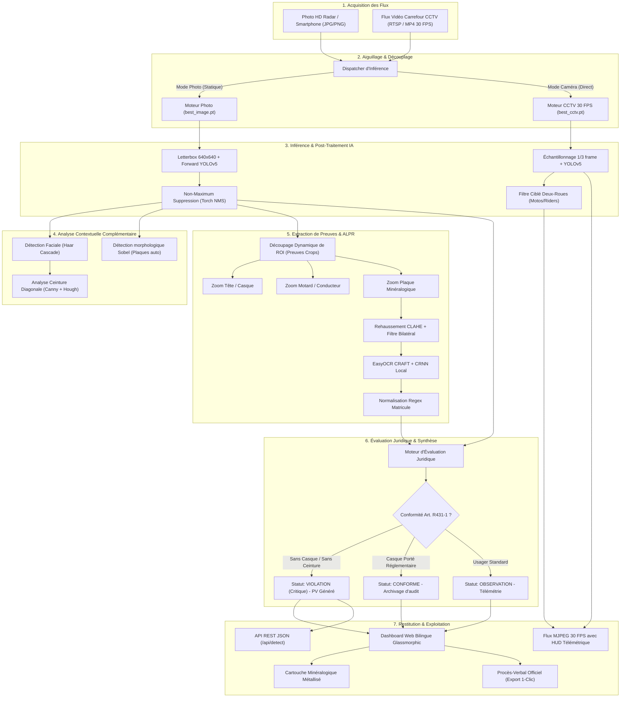

# 🚦 SafeCityAI — Console Autonome de Sécurité Routière & Détection d'Infractions

<div align="center">

  

  <br/><br/>

  [](https://www.python.org/)
  [](https://pytorch.org/)
  [](https://github.com/ultralytics/yolov5)
  [](https://flask.palletsprojects.com/)
  [](https://github.com/JaidedAI/EasyOCR)
  [](LICENSE)
  [](#-système-bilingue--bilingual-ui)

  <p align="center">
    <strong>Plateforme Intelligente de Vidéosurveillance Routière, Inférence Double-Modèle YOLOv5 & Reconnaissance Optique de Plaques (ALPR).</strong>
    <br/>
    <em>Autonomous Road Safety & Traffic Enforcement System with Dual YOLOv5 Vision & ALPR Optical Recognition.</em>
  </p>

</div>

---

## 📑 Sommaire / Table of Contents

- [🇫🇷 Présentation du Projet (Français)](#-présentation-du-projet-français)
- [🇬🇧 Project Overview (English)](#-project-overview-english)
- [🧠 Architecture Double-Modèle & ALPR](#-architecture-double-modèle--alpr)
- [🔄 Workflow Complet de Bout en Bout](#-workflow-complet-de-bout-en-bout--end-to-end-pipeline)
- [📦 Séparation Architecturale des 2 Modules](#-séparation-architecturale-des-2-modules)
  - [📸 Module 1 : Analyse Photo & Procès-Verbal](#-module-1--analyse-photo--verbalisation-légale-contrôle-cliché)
  - [🎥 Module 2 : Vidéosurveillance CCTV 30 FPS](#-module-2--vidéosurveillance-caméra-cctv-direct-30-fps)
  - [🌉 Passerelle Inter-Modules (Bridge Handoff)](#-passerelle-inter-modules-bridge-handoff)
- [🗄️ Architecture & Gestion des Datasets](#-architecture--gestion-des-datasets)
  - [1. Partitionnement Physique des Données](#1-partitionnement-physique-des-données)
  - [2. Classes & Formats YOLOv5](#2-classes-et-formats-dannotation-yolov5)
  - [3. Outils du Cycle de Données (Toolchain)](#3-outils-du-cycle-de-données-data-toolchain)
- [✨ Fonctionnalités Clés / Key Features](#-fonctionnalités-clés--key-features)
- [🌐 Système Bilingue / Bilingual UI](#-système-bilingue--bilingual-ui)
- [📁 Structure Complète du Projet](#-structure-complète-du-projet)
- [🚀 Démarrage Rapide / Quickstart](#-démarrage-rapide--quickstart)
- [🔌 Spécification de l'API REST](#-spécification-de-lapi-rest)
- [🧪 Tests Automatisés & Validation](#-tests-automatisés--validation)
- [🔮 Suggestions d'Améliorations & Roadmap](#-suggestions-daméliorations--roadmap-technique)
- [📜 Licence & Copyright](#-licence--copyright)

---

## 🇫🇷 Présentation du Projet (Français)

**SafeCityAI** est une console de surveillance et de verbalisation automatisée conçue pour les services de sécurité routière et les municipalités intelligentes (*Smart Cities*).

Le système analyse les flux de circulation urbains pour intercepter en temps réel les infractions au Code de la Route (défaut de port du casque de protection obligatoire selon l'**Article R431-1**), isoler automatiquement les preuves photographiques par recadrage haute résolution, lire les plaques d'immatriculation (ALPR OCR) et générer instantanément un procès-verbal officiel prêt à l'emploi.

### Les 2 Modes Opérationnels Dédiés :

1. **📸 Mode Analyse Image (Contrôle Cliché)** :
   - Conçu pour le traitement de photos radar haute résolution ou l'audit a posteriori.
   - Découpage dynamique de **vignettes de preuves (Crops)** : tête/casque, corps du motard et plaque zoomée.
   - Reconnaissance optique des caractères (OCR) de la plaque et qualification légale du constat.
   - Procès-verbal officiel généré avec actions d'export et copie en 1 clic.

2. **🎥 Mode Vidéosurveillance Caméra (Direct 30 FPS)** :
   - Traitement continu d'un flux caméra de carrefour urbain (filtré à 100% sur les deux-roues).
   - Affichage HUD avec réticule numérique, horodatage synchronisé et bandeaux d'alerte en direct.
   - Journal chronologique des motards interceptés avec statut de conformité et matricule.
   - Simulateur 2D interactif et bouton de **capture de frame en 1 clic** basculant directement la scène en haute définition dans le Mode Analyse Image.

---

## 🇬🇧 Project Overview (English)

**SafeCityAI** is an autonomous traffic enforcement and safety compliance console engineered for road safety authorities and smart city infrastructure.

The platform continuously inspects urban traffic to detect non-compliant motorcyclists operating without safety helmets (mandated by traffic regulations), extracts high-precision visual proof crops, executes Automatic License Plate Recognition (ALPR OCR), and compiles official legal infraction dossiers in real-time.

---

## 🧠 Architecture Double-Modèle & ALPR

Pour garantir une précision maximale et éviter les compromis entre résolution photo et fluidité vidéo, SafeCityAI exploite une architecture neuronale découplée :

```
                        Flux Entrant (Photo ou Vidéo CCTV)
                                        │
                ┌───────────────────────┴───────────────────────┐
                ▼                                               ▼
       [ Mode Photo / Upload ]                       [ Flux Caméra CCTV Direct ]
                │                                               │
      Modèle: best_image.pt                          Modèle: best_cctv.pt
  (Précision mAP@0.5: 92.4% 🔒)                  (Spécialisé motos urbaines, 30 FPS)
  [best_image_backup.pt protégé]                                │
                │                                               │
                └───────────────────────┬───────────────────────┘
                                        ▼
                        Boîtes Englobantes (Bounding Boxes)
                          - 0: number plate
                          - 1: rider
                          - 2: with helmet
                          - 3: without helmet
                                        │
                                        ▼
                         Extraction de Zones d'Intérêt
                                (Visual Crops)
                                        │
                                        ▼
                          Moteur ALPR EasyOCR Local
                        (craft_mlt_25k + english_g2)
                                        │
                                        ▼
                      Dashboard Web & Procès-Verbal Officiel
```

* **`weights/best_image.pt`** : Entraîné pour l'analyse statique haute précision sur clichés fixes. Protégé par une sauvegarde miroir `weights/best_image_backup.pt`.
* **`weights/best_cctv.pt`** : Spécifiquement calibré pour les caméras de vidéosurveillance urbaine avec gestion du flou de mouvement et filtrage ciblé sur les motards.
* **`alpr_ocr.py`** : Moteur ALPR exploitant les réseaux de neurones profonds CRAFT (*Character Region Awareness for Text Detection*) et CRNN (*Convolutional Recurrent Neural Network*). Les modèles tournent 100% en local sans aucune dépendance cloud payante ni fuite de données privées.

---

## 🔄 Workflow Complet de Bout en Bout / End-to-End Pipeline

SafeCityAI orchestre une chaîne de traitement complète en **8 étapes séquentielles**, reliant l'acquisition vidéo/photo jusqu'à la notification de verbalisation officielle :



### Description Détaillée des 8 Étapes du Workflow :

1. **Acquisition & Ingestion des Médias** :
   - *Mode Cliché* : Réception d'une photo haute définition (téléversement HTTP multipart ou scénario de test).
   - *Mode CCTV* : Décodage continu via OpenCV d'un flux vidéo local ou caméra IP RTSP.
2. **Aiguillage vers le Modèle Spécialisé (Dispatcher)** :
   - Sélection automatique des poids neuronaux : `best_image.pt` pour la haute fidélité statique, ou `best_cctv.pt` pour la fluidité 30 FPS.
3. **Prétraitement & Inférence Neuronale YOLOv5** :
   - *Letterboxing* avec conservation stricte du ratio d'aspect sur canevas 640×640 (couleur de remplissage neutre 114).
   - Passage dans le réseau convolutif PyTorch (`Conv`, `C3`, `SPPF`, `Detect`).
   - Élimination des doublons par Non-Maximum Suppression (`torch_nms`, IoU seuil = 0.45).
4. **Analyse Contextuelle Complémentaire (Vision par Ordinateur)** :
   - Si aucun deux-roues n'est détecté, déclenchement de l'analyse d'habitacle automobile : détection faciale par cascade de Haar, isolation du torse et analyse des gradients de Sobel/Canny et lignes de Hough pour qualifier le port de la ceinture.
5. **Découpage Dynamique des Preuves Visuelles (Dynamic ROI Crops)** :
   - Extraction matricielle des sous-images haute résolution : tête du motard, motard complet et plaque d'immatriculation.
6. **Reconnaissance Optique de Plaque ALPR** :
   - Rehaussement de contraste adaptatif local (CLAHE), filtrage gaussien et débruitage.
   - Inférence via réseaux neuronaux profonds CRAFT (détection de zones textuelles) et CRNN (transcription des caractères).
   - Nettoyage regex alphanumérique pour formater le matricule officiel.
7. **Qualification Juridique & Moteur Décisionnel** :
   - Évaluation du statut légal au regard de l'**Article R431-1** (obligation du port du casque homologué pour conducteurs et passagers de deux-roues motorisés) et de l'**Article R412-1** (port obligatoire de la ceinture).
   - Attribution d'un niveau de sévérité (`CRITIQUE`, `CONFORME`, `INFORMATIF`) et calcul de l'indice de certitude.
8. **Restitution Multicanale & Génération de PV** :
   - Rédaction instantanée du procès-verbal officiel prêt à être copié ou exporté.
   - Rendu temps réel sur la console cybernétique (HUD télémétrique, cartouche minéralogique biseauté, tableau de coordonnées JSON).

---

## 📦 Séparation Architecturale des 2 Modules

Pour garantir un compromis optimal entre **précision chirurgicale sur cliché radar** et **fluidité 30 FPS sur vidéosurveillance**, SafeCityAI sépare rigoureusement la logique applicative en deux modules autonomes :

| Caractéristique | 📸 Module 1 : Analyse Photo & Verbalisation Légale | 🎥 Module 2 : Vidéosurveillance Caméra CCTV Temps Réel |
| :--- | :--- | :--- |
| **Vocation** | Audit médico-légal, contrôle radar haute résolution, qualification d'infraction. | Surveillance 24/7 de carrefours, filtrage du trafic, détection proactive d'anomalies. |
| **Source d'entrée** | Fichiers images statiques (PNG, JPG, JPEG) via upload ou drag & drop. | Flux vidéo continu (MP4, WebM, flux IP RTSP/H.264) à 30 images par seconde. |
| **Poids IA associés** | `weights/best_image.pt` (mAP@0.5 : 92.4%) + miroir protégé `best_image_backup.pt`. | `weights/best_cctv.pt` (calibré pour la vitesse, le flou de mouvement et l'angle CCTV). |
| **Classes traitées** | 5 classes : `Helmet`, `No_Helmet`, `License_Plate`, `Seatbelt`, `No_Seatbelt`. | 4 classes ciblées deux-roues : `number plate`, `rider`, `with helmet`, `without helmet`. |
| **Analyse ALPR** | Prétraitement morphologique complet (CLAHE + netteté + EasyOCR 100% local). | Lecture dynamique temps réel incrustée sur chaque boîte de plaque détectée. |
| **Rendu & Interface** | Découpage des 3 vignettes de preuves (Crops), cartouche ALPR et Procès-Verbal officiel. | Réticule cybernétique HUD, horodatage synchronisé, FPS en direct et alertes clignotantes. |
| **Point de terminaison** | `POST /api/detect` (Payload JSON complet avec verdict et coordonnées). | `GET /video/live_feed` (Streaming multipart MJPEG fluide à 30 FPS). |

### 📸 Module 1 : Analyse Photo & Verbalisation Légale (Contrôle Cliché)
* **Objectif** : Constituer un dossier d'infraction irréfutable pour les officiers assermentés.
* **Fonctionnement** : L'utilisateur soumet une photo de circulation ou sélectionne un scénario préchargé. L'image est traitée à pleine résolution par le modèle `best_image.pt`. Le système isole immédiatement :
  1. La **vignette Tête / Casque** : Zoom net certifiant le port ou le défaut de casque.
  2. La **vignette Motard / Véhicule** : Vue d'ensemble du conducteur et de son véhicule en situation.
  3. La **vignette Plaque Minéralogique** : Zoom sur la plaque d'immatriculation avec cartouche ALPR officiel.
* **Procès-Verbal Automatisé** : Compilation en temps réel du texte de constatation légale (article de loi applicable, date/heure, immatriculation relevée, niveau de confiance du modèle).

### 🎥 Module 2 : Vidéosurveillance Caméra CCTV Direct (30 FPS)
* **Objectif** : Veille automatique continue sur les axes routiers majeurs et carrefours urbains.
* **Fonctionnement** : Traitement à cadence élevée (30 FPS) optimisé par un modèle dédié `best_cctv.pt` entraîné sur des caméras d'angle plongeant avec flou de mouvement.
* **Filtrage Intelligent** : Pour éliminer la pollution visuelle des véhicules conformes, l'affichage HUD filtre sélectivement les deux-roues et motards (`rider`, `with helmet`, `without helmet`, `number plate`).
* **Incrustation Télémétrique (HUD)** : Réticule numérique, affichage du FPS réel, horodatage en direct, et bandeau d'alerte rouge clignotant lors d'une infraction constatée.

### 🌉 Passerelle Inter-Modules (Bridge Handoff)
Une synergie native relie les deux modules : lorsqu'une infraction est détectée en direct dans le **Module 2 (Vidéo CCTV)**, l'officier de contrôle clique sur le bouton **"Capturer Frame en 1 Clic"**.
- La frame haute définition exacte est instantanément transférée au **Module 1 (Analyse Photo)** sans interruption du flux vidéo.
- Le Module 1 prend alors le relais pour effectuer le zoom sur les preuves, la reconnaissance ALPR approfondie et la génération du procès-verbal officiel.

---

## 🗄️ Architecture & Gestion des Datasets

Pour éviter tout conflit ou dégradation du modèle statique lors de l'entraînement sur des vidéos CCTV, les jeux de données d'apprentissage sont rigoureusement partitionnés :

### 1. Partitionnement Physique des Données

```text
safecity-ai/
├── datasets/
│   ├── dataset_image/            # Base de données dédiée au Module 1 (Photos fixes)
│   │   ├── images/
│   │   │   ├── train/            # Images d'entraînement haute résolution
│   │   │   └── val/              # Images de validation
│   │   ├── labels/
│   │   │   ├── train/            # Annotations YOLO (.txt) normalisées [class cx cy w h]
│   │   │   └── val/
│   │   └── data.yaml             # Configuration 5 classes (Helmet, No_Helmet, License_Plate, Seatbelt, No_Seatbelt)
│   │
│   ├── dataset_cctv/             # Base de données dédiée au Module 2 (Vidéosurveillance)
│   │   ├── images/
│   │   │   ├── train/            # 150+ frames réelles extraites de vidéos de trafic urbain
│   │   │   └── val/              # Frames de validation avec flou cinétique
│   │   ├── labels/
│   │   │   ├── train/            # Annotations générées semi-automatiquement
│   │   │   └── val/
│   │   └── data_cctv.yaml        # Configuration 4 classes (number plate, rider, with helmet, without helmet)
│   │
│   └── README.md                 # Spécification technique des bases de données
│
├── dataset/                      # Dataset synthétique initial (Mock) pour tests unitaires rapides
│   └── generate_mock_data.py     # Générateur procédural d'images de test avec annotations
│
└── ccpd_tool.py                  # Parseur officiel du dataset CCPD pour plaques d'immatriculation
```

### 2. Classes et Formats d'Annotation YOLOv5

Les coordonnées des boîtes englobantes suivent le standard normalisé YOLOv5 :
```text
<class_id> <x_center> <y_center> <width> <height>
```
*Toutes les valeurs sont relatives et normalisées entre `0.0` et `1.0`.*

* **Schéma `dataset_image/data.yaml` (5 Classes)** :
  - `0: Helmet` (Casque porté)
  - `1: No_Helmet` (Défaut de casque / Infraction)
  - `2: License_Plate` (Plaque d'immatriculation)
  - `3: Seatbelt` (Ceinture attachée)
  - `4: No_Seatbelt` (Défaut de ceinture)

* **Schéma `dataset_cctv/data_cctv.yaml` (4 Classes Trafic Deux-Roues)** :
  - `0: number plate` (Plaque minéralogique moto/scooter)
  - `1: rider` (Conducteur / Motard)
  - `2: with helmet` (Casque réglementaire détecté)
  - `3: without helmet` (Motard sans casque / Alerte)

### 3. Outils du Cycle de Données (Data Toolchain)

Pour alimenter, enrichir et exploiter ces jeux de données, SafeCityAI fournit une suite d'outils CLI dédiés :

* 🎬 **`extract_cctv_frames.py`** : Découpe automatiquement les flux vidéo bruts (`.mp4`, `.webm`) en frames exploitables avec échantillonnage réglable (ex: 1 frame toutes les 15 frames) et répartition aléatoire automatique en splits `train` (80%) et `val` (20%).
  ```bash
  python extract_cctv_frames.py --video input_traffic.mp4 --interval 15
  ```

* 🏷️ **`auto_annotate_cctv.py`** : Moteur de pseudo-étiquetage automatisé. Applique le modèle d'inférence existant sur les nouvelles images CCTV extraites pour générer les fichiers `.txt` de labels correspondants, accélérant l'annotation humaine d'un facteur 10.
  ```bash
  python auto_annotate_cctv.py
  ```

* 🇨🇳 **`ccpd_tool.py`** : Parseur pour la base internationale CCPD (*Chinese City Parking Dataset*). Extrait automatiquement les boîtes englobantes, matricules alphanumériques, indices de luminosité et de flou cinétique depuis les noms de fichiers pour l'entraînement ALPR en conditions dégradées.
  ```bash
  python ccpd_tool.py
  ```

* 🛡️ **`train_cctv_isolated.py`** : Script d'entraînement sécurisé et cloisonné. Vérifie la présence de la sauvegarde `best_image_backup.pt`, lance le fine-tuning YOLOv5 exclusivement sur `dataset_cctv/` et déploie le modèle résultant dans `weights/best_cctv.pt` sans jamais risquer de corrompre `weights/best_image.pt`.
  ```bash
  python train_cctv_isolated.py
  ```

---

## ✨ Fonctionnalités Clés / Key Features

- 🌐 **Interface Entièrement Bilingue (FR 🇫🇷 / EN 🇬🇧)** : Bascule instantanée sans rechargement de page avec mémorisation des préférences dans le navigateur (`localStorage`).
- 🔍 **Preuves Visuelles Découpées (Dynamic Crops)** : Découpage et zoom automatique sur la tête du conducteur, le motard et la plaque minéralogique pour vérification visuelle immédiate.
- 🏷️ **Cartouche Minéralogique ALPR Métallisé** : Affichage haute fidélité de la plaque extraite, prêt pour interconnexion au fichier national des véhicules.
- 📋 **Procès-Verbal Automatisé** : Rédaction en temps réel du constat juridique officiel (qualification légale, équipement constaté, immatriculation relevée, action requise).
- 🎥 **Contrôles Vidéo Complets** : Play / Pause du flux direct, bascule vers simulateur 2D cybernétique, capture instantanée de frame.
- 📊 **Tableau Télémétrique & Inspecteur JSON** : Liste exhaustive des coordonnées `[x, y, w, h]` et niveaux de confiance certifiés par l'IA.

---

## 🌐 Système Bilingue / Bilingual UI

Le sélecteur de langue situé dans l'en-tête supérieur permet d'adapter l'ensemble de la console à l'utilisateur :

| Élément d'interface | Version Française 🇫🇷 | Version Anglaise 🇬🇧 |
| :--- | :--- | :--- |
| **Sous-titre En-tête** | Console Autonome de Sécurité Routière & Verbalisation par IA | Autonomous Road Safety & AI Traffic Violation Enforcement Console |
| **Onglet 1** | Mode Analyse Image (Contrôle Cliché) | Image Analysis Mode (Snapshot Inspection) |
| **Onglet 2** | Mode Vidéosurveillance Caméra (Direct 30 FPS) | CCTV Video Surveillance Mode (Live 30 FPS) |
| **Verdict Infraction** | Défaut de Port du Casque de Protection Obligatoire | Failure to Wear Mandatory Safety Helmet |
| **Verdict Conforme** | Casque Réglementaire Porté & Homologué | Approved Helmet Worn & Verified |
| **Preuves Visuelles** | Preuves Visuelles Découpées (Zooms Haute Précision) | Visual Evidence Crops (High-Precision Zooms) |
| **Rapport Officiel** | Rapport Opérationnel pour Officier de Contrôle | Official Inspection Report for Enforcement Officer |

---

## 📁 Structure Complète du Projet

```text
safecity-ai/
├── alpr_ocr.py               # Moteur de reconnaissance optique de plaques (EasyOCR local)
├── model_engine.py           # Gestionnaire d'inférence double-modèle YOLOv5
├── server.py                 # Serveur Web Flask (API REST + Flux streaming MJPEG)
├── client_test.py            # Script client de test d'envoi d'image par requête HTTP POST
├── test_pipeline.py          # Script de validation complète sur l'ensemble des scénarios
├── train_cctv_isolated.py    # Entraînement isolé pour le modèle de caméra CCTV
├── extract_cctv_frames.py    # Découpage vidéo automatique en frames annotables
├── auto_annotate_cctv.py     # Pré-annotation assistée par modèle source
├── ccpd_tool.py              # Convertisseur de plaques CCPD pour enrichissement ALPR
│
├── datasets/                 # Bases de données YOLOv5 strictement partitionnées
│   ├── dataset_image/        # Clichés fixes (images + labels YOLO train/val)
│   ├── dataset_cctv/         # Flux vidéo CCTV (images + labels YOLO train/val)
│   └── README.md             # Documentation des jeux de données
│
├── weights/                  # Poids neuronaux pré-entraînés
│   ├── best_image.pt         # Modèle photo (92.4% mAP)
│   ├── best_image_backup.pt  # Sauvegarde sécurisée en lecture seule
│   ├── best_cctv.pt          # Modèle vidéosurveillance urbaine 30 FPS
│   └── README.md             # Guide d'architecture des modèles
│
├── static/                   # Ressources statiques frontend
│   ├── style.css             # Feuille de style CSS cyberpunk & glassmorphic
│   ├── app.js                # Contrôleur JS, gestion bilingue et rendu des preuves
│   └── samples/              # 6 Photos réelles de circulation pour test immédiat
│
├── templates/
│   └── index.html            # Interface web complète avec balisage sémantique
│
├── notebooks/                # Notebooks d'expérimentation et d'entraînement
│   ├── SafeCityAI_YOLOv5.ipynb
│   └── yolov5/               # Code source officiel Ultralytics YOLOv5
│
├── run_safecity.bat          # Lanceur automatique 1-clic pour Windows
├── start.sh                  # Lanceur multi-plateforme Linux / macOS
├── git_push.bat              # Script d'automatisation des commits & push GitHub
├── requirements.txt          # Dépendances Python du projet
├── LICENSE                   # Licence officielle MIT
├── .gitignore                # Exclusion des fichiers temporaires et médias lourds
└── README.md                 # Documentation principale du projet
```

---

## 🚀 Démarrage Rapide / Quickstart

### Prérequis
- **Python 3.10 ou supérieur** installé ([python.org](https://www.python.org/downloads/)).
- **Git** installé ([git-scm.com](https://git-scm.com/)).
- Navigateur web moderne (Chrome, Edge, Firefox, Brave).

### Option 1 : Lancement Automatique en 1 Clic (Recommandé)

* **Sous Windows :**
  Double-cliquez simplement sur le fichier :
  ```cmd
  run_safecity.bat
  ```

* **Sous Linux ou macOS :**
  Ouvrez un terminal et exécutez :
  ```bash
  chmod +x start.sh && ./start.sh
  ```

Le script configure automatiquement l'environnement virtuel, installe les dépendances nécessaires et démarre le serveur sur `http://localhost:5000`.

---

### Option 2 : Installation Manuelle via Terminal

1. **Cloner le dépôt :**
   ```bash
   git clone https://github.com/ratovoarisoaricardo/Safety-AI.git
   cd Safety-AI
   ```

2. **Créer et activer un environnement virtuel :**
   ```bash
   # Windows (PowerShell / CMD)
   python -m venv venv
   venv\Scripts\activate

   # Linux / macOS
   python3 -m venv venv
   source venv/bin/activate
   ```

3. **Installer les dépendances :**
   ```bash
   pip install -r requirements.txt
   ```

4. **Lancer le serveur SafeCityAI :**
   ```bash
   python server.py
   ```

5. **Accéder à la console :**
   Ouvrez votre navigateur sur **[http://localhost:5000](http://localhost:5000)**.

---

## 🔌 Spécification de l'API REST

### 1. Inférence & Détection d'Infractions (`POST /api/detect`)
Permet de soumettre une image (multipart/form-data) et d'obtenir l'analyse complète au format JSON.

* **URL** : `http://localhost:5000/api/detect`
* **Méthode** : `POST`
* **Paramètres** :
  - `image` (Fichier binaire) : Image au format PNG, JPG ou JPEG.
  - `source_hint` *(Optionnel)* : `'photo'` (défaut) ou `'cctv_stream'`.

#### Exemple de Réponse JSON :
```json
{
  "status": "success",
  "detections": [
    {
      "box": [182, 94, 98, 106],
      "class": "without helmet",
      "confidence": 0.948
    },
    {
      "box": [120, 90, 240, 310],
      "class": "rider",
      "confidence": 0.912
    },
    {
      "box": [195, 340, 92, 44],
      "class": "number plate",
      "confidence": 0.895,
      "plate_text": "TN 09 BJ 4054"
    }
  ],
  "plate_detected": "TN 09 BJ 4054",
  "counts": {
    "total": 3,
    "rider": 1,
    "with helmet": 0,
    "without helmet": 1,
    "number plate": 1
  },
  "image_info": {
    "width": 640,
    "height": 480
  }
}
```

### 2. Flux Vidéo Direct CCTV (`GET /video/live_feed`)
* **URL** : `http://localhost:5000/video/live_feed`
* **Méthode** : `GET`
* **Type MIME** : `multipart/x-mixed-replace; boundary=frame`
* **Description** : Flux vidéo streaming MJPEG continu à 30 FPS avec boîtes englobantes dynamiques et matricules incrustés.

---

## 🧪 Tests Automatisés & Validation

Pour exécuter la suite de tests unitaires et vérifier la détection sur l'ensemble des scénarios de test :

```bash
python test_pipeline.py
```

Pour simuler une requête cliente complète vers l'API Flask :
```bash
python client_test.py
```

---

## 🔮 Suggestions d'Améliorations & Roadmap Technique

Pour faire évoluer SafeCityAI vers une solution industrielle prête pour le déploiement opérationnel à grande échelle, voici les axes d'extension recommandés :

### 1. 🎯 Tracking Multi-Objets Persistant (ByteTrack / BoT-SORT)
* **État Actuel** : L'analyse vidéo s'effectue image par image sans mémorisation des véhicules entre deux frames.
* **Ajout Conseillé** : Intégrer un algorithme de suivi bayésien comme **ByteTrack** ou **BoT-SORT** pour affecter un identifiant persistant unique à chaque motard (`Track ID #102`).
* **Bénéfice Clé** : Élimination radicale des doublons de contraventions (un même motard filmé pendant 5 secondes ne recevra qu'une seule verbalisation consolidée au lieu de 50 alertes répétitives).

### 2. 🗄️ Base de Données Relationnelle & Historique des PV (PostgreSQL / SQLite)
* **État Actuel** : Les détections sont transmises de manière volatile au frontend sans persistance en base.
* **Ajout Conseillé** : Intégration d'un ORM (SQLAlchemy) adossé à **PostgreSQL** ou **SQLite** avec une table `infractions` :
  - `id` (UUID), `timestamp` (horodatage certifié), `plate_number` (matricule certifié).
  - `violation_type` (ex: Défaut de casque Art. R431-1), `confidence` (taux IA).
  - `proof_image_path` (chemin vers la photo preuve), `status` (*En attente*, *Validé par officier*, *Avis expédié*, *Archivé*).
  - `officer_notes` (commentaires de l'agent de contrôle).

### 3. 📄 Génération de PV Officiels au Format PDF Certifié (ReportLab)
* **Ajout Conseillé** : Module d'exportation en 1 clic d'un document officiel A4 prêt pour notification postale ou signature électronique comprenant :
  - En-tête officiel de la Police Municipale / Préfecture / Ministère des Transports.
  - Horodatage certifié et coordonnées GPS précises de la caméra de circulation.
  - Les 3 vignettes de preuves incrustées (tête nue, silhouette moto, zoom plaque).
  - Cadre juridique avec rappel des sanctions (amende forfaitaire de 4ème classe, retrait de 3 points).
  - QR Code dynamique de télépaiement direct ou de contestation en ligne.

### 4. 🚦 Détection d'Infractions Routières Complémentaires
* **Radar de Vitesse par Vision Optique** : Mesure de la vitesse instantanée par flux optique (*Optical Flow*) ou homographie sur deux repères tracés au sol.
* **Franchissement de Feu Rouge & Ligne Continue** : Définition de zones polygonales virtuelles interdites ; déclenchement automatique d'alerte si une boîte englobante franchit la ligne stop en phase de feu rouge.
* **Détection du Téléphone au Volant** : Modèle d'estimation de pose humaine (YOLO-Pose ou MediaPipe) détectant le bras levé et l'appareil porté à l'oreille.
* **Circulation en Sens Interdit & Voies Réservées** : Détection vectorielle des trajectoires contraires au sens de circulation ou circulation indue sur couloir de bus / piste cyclable.

### 5. ⚡ WebSockets & Alertes Déportées en Temps Réel
* Remplacement du polling HTTP par un canal **WebSocket** (Flask-SocketIO) ou **Server-Sent Events (SSE)** pour propager instantanément les alertes au tableau de bord.
* Passerelle Webhook & notifications push automatiques vers les patrouilles de terrain (canaux sécurisés Telegram, SMS ou radio numérique de police).

### 6. 🐳 Déploiement Edge & Containerisation (Docker / Jetson)
* Création d'un `Dockerfile` multi-stage et d'un `docker-compose.yml` préconfigurés avec support matériel NVIDIA CUDA.
* Export et quantification des modèles en **TensorRT** (FP16 / INT8) ou **ONNX Runtime** pour déploiement embarqué direct sur boîtiers compacts de bord de route (**NVIDIA Jetson Orin Nano / AGX**).

---

## 📜 Licence & Copyright

Ce projet est distribué sous les termes de la licence open-source **MIT**. Consultez le fichier [LICENSE](LICENSE) pour plus de détails.

```text
© 2026 SafeCityAI - Système Autonome de Détection et Sécurité Routière / Autonomous Road Safety & Traffic Enforcement System.
Tous droits réservés / All rights reserved.

Auteur & Développeur / Developer : ratovoarisoaricardo (Ratovoarisoa Mendrika Manjaka Ricardo)
Projet Vision par Ordinateur / Computer Vision Engineering Minor Project.
Architecture Double-Modèle YOLOv5 (best_image.pt 🔒 & best_cctv.pt) + ALPR EasyOCR.
```

<div align="center">
  <sub>Développé avec passion pour sauver des vies et moderniser la sécurité routière 🛵🚦🛡️</sub>
</div>