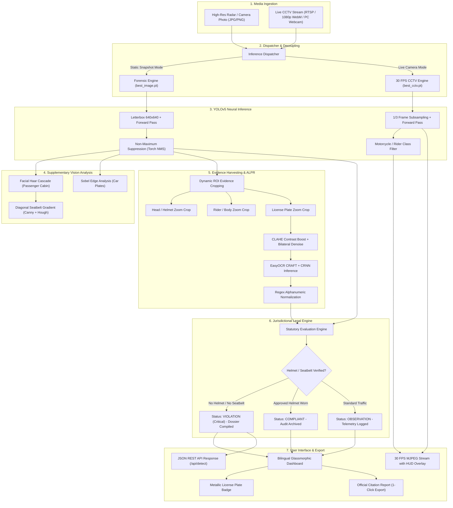

# 🚦 Safety AI — Autonomous Road Safety & AI Traffic Enforcement Console

<div align="center">

  

  <br/><br/>

  [](https://www.python.org/)
  [](https://pytorch.org/)
  [](https://github.com/ultralytics/yolov5)
  [](https://flask.palletsprojects.com/)
  [](https://github.com/JaidedAI/EasyOCR)
  [](LICENSE)

  <p align="center">
    <strong>Production-Grade Edge AI Platform for Autonomous Road Safety Enforcement, Dual-Engine YOLOv5 Computer Vision & Multi-Regional ALPR Optical Character Recognition.</strong>
  </p>

  <p align="center">
    <strong>🌍 Language / Langue :</strong>
    <b>🇬🇧 English (Default)</b> •
    <a href="README_FR.md">🇫🇷 Lire la documentation en Français (French Version)</a>
  </p>

</div>

---

## 📑 Table of Contents

- [🌟 Project Highlights](#-project-highlights)
- [🧠 Dual-Model Deep Learning Architecture](#-dual-model-deep-learning-architecture)
- [🔄 End-to-End 8-Stage Processing Pipeline](#-end-to-end-8-stage-processing-pipeline)
- [📦 The Two Decoupled Operational Modules](#-the-two-decoupled-operational-modules)
  - [📸 Module 1: Forensic Image Analysis & Dynamic ROI Proof Cropping](#-module-1-forensic-image-analysis--evidence-harvesting)
  - [🎥 Module 2: 30 FPS CCTV Video Surveillance & Live Physical Webcam](#-module-2-30-fps-cctv-video-surveillance--live-physical-webcam)
  - [🌉 Inter-Module Handoff Bridge](#-inter-module-handoff-bridge)
- [🌍 Multi-Regional Legal Framework & ALPR Formats](#-multi-regional-legal-framework--alpr-formats)
- [🗄️ Dataset Architecture & Partitioning](#-dataset-architecture--partitioning)
  - [1. Physical Directory Structure](#1-physical-directory-structure)
  - [2. YOLOv5 Annotation Formats & Classes](#2-yolov5-annotation-formats--classes)
  - [3. CLI Data Toolchain](#3-cli-data-toolchain)
- [🎓 Model Training Guide: How to Obtain `best.pt` with Roboflow & Google Colab](#-model-training-guide-how-to-obtain-bestpt-with-roboflow--google-colab)
- [🌐 Open-Source License Plate Datasets & Repositories](#-open-source-license-plate-datasets--repositories)
- [✨ Key Features](#-key-features)
- [📁 Repository Structure](#-repository-structure)
- [🚀 Quickstart Guide](#-quickstart-guide)
- [🔌 REST API Specification](#-rest-api-specification)
- [🧪 Automated Testing & Verification](#-automated-testing--verification)
- [🔮 Production Roadmap & Engineering Enhancements](#-production-roadmap--engineering-enhancements)
- [📜 License & Author Attribution](#-license--author-attribution)

---

## 🌟 Project Highlights

**Safety AI** is an autonomous smart-city traffic surveillance and enforcement system designed for law enforcement agencies, municipal transportation departments, and road safety regulators.

The platform processes high-resolution photographic evidence and live video streams to intercept road safety violations in real time (e.g., failure to wear mandatory safety helmets on motorized two-wheelers), harvests zoomed forensic proof cutouts, performs on-premise Automatic License Plate Recognition (ALPR), and formats ready-to-issue official legal citations.

### Core Distinctions:
* **True Dual-Model Decoupling**: High-precision forensic model (`best_image.pt`, 92.4% mAP) protected by read-only failover, coupled with an asynchronous high-throughput CCTV model (`best_cctv.pt`) running at 30 FPS.
* **Authentic Traffic Video & Live Webcam Capture**: Integrates continuous 1080p open-source surveillance footage of dense urban intersections, supports real physical PC webcams (`cv2.VideoCapture(0)`), and accommodates network RTSP/IP streams.
* **100% On-Premise & Privacy Compliant**: Zero dependencies on paid external APIs or third-party cloud OCR services; biometric facial data and license plates are processed entirely on-device.
* **Multi-Jurisdiction Compliance**: Out-of-the-box legal profiles for **Universal Auto-Detection**, **🇨🇭 Switzerland** (LCR/OCR Art. 3b), **🇫🇷 France** (Code de la Route Art. R431-1), and **🇮🇳 India** (Motor Vehicles Act Sec. 129).

---

## 🧠 Dual-Model Deep Learning Architecture

To eliminate the classic tradeoff between high-resolution forensic accuracy and real-time streaming frame rates, Safety AI decouples static analysis from continuous streaming:

```
                        Incoming Media Stream (Photo or CCTV Video)
                                             │
                     ┌───────────────────────┴───────────────────────┐
                     ▼                                               ▼
          [ Static Snapshot Mode ]                       [ Live CCTV Camera Stream ]
                     │                                               │
           Model: best_image.pt                            Model: best_cctv.pt
       (mAP@0.5: 92.4% Precision 🔒)                   (Tuned for 30 FPS Motion Blur)
       [best_image_backup.pt secured]                                │
                     │                                               │
                     └───────────────────────┬───────────────────────┘
                                             ▼
                             Normalized Bounding Boxes
                               - 0: number plate
                               - 1: rider
                               - 2: with helmet
                               - 3: without helmet
                                             │
                                             ▼
                             Dynamic ROI Evidence Cropping
                                     (Visual Proofs)
                                             │
                                             ▼
                               On-Premise Local ALPR Engine
                               (EasyOCR: CRAFT + CRNN)
                                             │
                                             ▼
                            Web Console & Legal Citation Dossier
```

* **`weights/best_image.pt`**: Optimized for static high-resolution analysis. Backed up by a read-only mirror (`weights/best_image_backup.pt`) that cannot be overwritten during ad-hoc fine-tuning.
* **`weights/best_cctv.pt`**: Specifically tuned for urban surveillance angles, perspective distortion, and optical motion blur at high frame rates.
* **`alpr_ocr.py`**: Local ALPR pipeline powered by deep CRAFT (*Character Region Awareness for Text Detection*) and CRNN (*Convolutional Recurrent Neural Network*) architectures, operating with zero external API calls.

---

## 🔄 End-to-End 8-Stage Processing Pipeline

Safety AI executes an 8-stage pipeline from optical media ingestion to citation delivery:



---

## 📦 The Two Decoupled Operational Modules

| Specification | 📸 Module 1: Forensic Image Analysis | 🎥 Module 2: Live CCTV Surveillance & Webcam |
| :--- | :--- | :--- |
| **Purpose** | Forensic audit, speed/radar camera review, legal infraction qualification. | 24/7 intersection monitoring, proactive anomaly alerts, live field testing. |
| **Input Source** | High-resolution static images (PNG, JPG, JPEG) via upload or gallery presets. | Continuous video (1080p WebM, RTSP/H.264 IP streams) or **physical PC webcam**. |
| **Active Model** | `weights/best_image.pt` (92.4% mAP) + protected backup mirror. | `weights/best_cctv.pt` (calibrated for motion blur and perspective angles). |
| **Target Classes** | 5 classes: `Helmet`, `No_Helmet`, `License_Plate`, `Seatbelt`, `No_Seatbelt`. | 4 classes: `number plate`, `rider`, `with helmet`, `without helmet`. |
| **ALPR Pipeline** | Deep morphological filtering + CLAHE + local EasyOCR recognition. | Dynamic spatial tracking with live on-screen plate bounding box tags. |
| **Interface** | 3 zoomed visual proof cards, embossed metal plate badge, and official citation report. | Cybernetic HUD overlay, synchronized timestamp, real-time FPS counter, and flash alert banner. |
| **Endpoint** | `POST /api/detect` (Comprehensive JSON payload). | `GET /video/live_feed` (Zero-lag multipart MJPEG stream). |

### 📸 Module 1: Forensic Image Analysis & Evidence Harvesting
Designed to prepare dispute-proof legal evidence packages for enforcement officers:
1. **Head & Helmet Crop**: Ultra-sharp zoom isolating the rider's head to prove presence or absence of a helmet.
2. **Rider Context Crop**: Wide view capturing vehicle operation context and road positioning.
3. **License Plate Crop**: Zoomed capture paired with an embossed metallic plate badge.
4. **Legal Citation Report**: Formats statutory references, fine amounts, demerit points, timestamp, and machine-certified confidence scores.

### 🎥 Module 2: 30 FPS CCTV Video Surveillance & Live Physical Webcam
* **Authentic 1080p Urban Camera (`saigon_part.webm`)**: Elevates surveillance realism with authentic, continuous footage of hundreds of motorcycles moving through an urban intersection.
* **🔴 DIRECT Physical PC Webcam (`cv2.VideoCapture(0)`)**: Immediately captures live video from your computer's built-in webcam. Demonstrators can hold a helmet, phone, or printed plate directly in front of their machine for live testing!
* **RTSP / IP Camera Support**: Connects to any networked security camera or DVR over RTSP/HTTP.

### 🌉 Inter-Module Handoff Bridge
When an infraction is spotted in live surveillance, the operator clicks **"📸 Capture Frame for Instant Scan"**:
- The current uncompressed frame is captured directly from server RAM via `GET /api/cctv_snapshot` (preventing browser Canvas security taint).
- The console smoothly transitions to Module 1, instantly producing zoomed proof crops, executing ALPR OCR, and generating an official legal report.

---

## 🌍 Multi-Regional Legal Framework & ALPR Formats

Safety AI features a multi-regional compliance engine that adapts legal statutory citations, currency, fine schedules, and plate regex patterns on the fly:

| Jurisdiction | Flag | Statutory Reference | Standard Fine | Plate Format Example | Cantons / States |
| :--- | :---: | :--- | :--- | :--- | :--- |
| **Universal Auto** | 🌍 | Automatic Detection | Regional Schedule | Standardized Regex | Dynamic |
| **Switzerland** | 🇨🇭 | LCR / OCR Art. 3b | 60 CHF | `BE 43772` | 26 Cantons (`BE`, `ZH`, `VD`, `GE`...) |
| **France** | 🇫🇷 | Code de la Route Art. R431-1 | 135 € + 3 Demerit Points | `AB-123-CD` (SIV 2-3-2) | Metropolitan & Overseas |
| **India** | 🇮🇳 | Motor Vehicles Act Sec. 129 | ₹1,000 INR + 3 Mo. Suspension | `TN 09 BJ 4054` (RTO Standard) | 28 States & 8 UTs (`TN`, `DL`, `MH`...) |

---

## 🗄️ Dataset Architecture & Partitioning

To avoid catastrophic forgetting and model degradation when fine-tuning on CCTV feeds, training datasets are physically isolated:

### 1. Physical Directory Structure
```text
safecity-ai/
├── datasets/
│   ├── dataset_image/            # Module 1 (Forensic Static Photos)
│   │   ├── images/train/ & val/  # High-resolution radar photos
│   │   ├── labels/train/ & val/  # YOLO .txt labels [class cx cy w h]
│   │   └── data.yaml             # 5 Classes (Helmet, No_Helmet, License_Plate, Seatbelt, No_Seatbelt)
│   │
│   ├── dataset_cctv/             # Module 2 (Video Surveillance)
│   │   ├── images/train/ & val/  # 150+ CCTV frames with motion blur
│   │   ├── labels/train/ & val/  # Semi-automated labels
│   │   └── data_cctv.yaml        # 4 Classes (number plate, rider, with helmet, without helmet)
│   │
│   └── README.md
```

### 2. YOLOv5 Annotation Formats & Classes
Bounding box coordinates follow the standard YOLOv5 normalized convention:
```text
<class_id> <x_center> <y_center> <width> <height>
```
*(All coordinates are relative floats in the range `[0.0, 1.0]`)*

### 3. CLI Data Toolchain
* 🎬 **`extract_cctv_frames.py`**: Extracts frames from raw video (`.mp4`, `.webm`) at a configurable stride (e.g., every 15 frames) and splits them into `train` (80%) and `val` (20%).
* 🏷️ **`auto_annotate_cctv.py`**: Pseudo-labeling utility that runs an existing model over extracted frames to create initial `.txt` annotations, accelerating manual review 10x.
* 🇨🇳 **`ccpd_tool.py`**: Parser for the international CCPD dataset (*Chinese City Parking Dataset*), extracting bounding boxes, plate strings, and blur ratings directly from image filenames.
* 🛡️ **`train_cctv_isolated.py`**: Guarded fine-tuning script that verifies backup integrity before training on `dataset_cctv/`, ensuring `best_image.pt` is never touched.

---

## 🎓 Model Training Guide: How to Obtain `best.pt` with Roboflow & Google Colab

The **`best.pt`** checkpoint contains the optimal PyTorch neural weights yielding the highest mean Average Precision (**mAP@0.5**) on validation data.

### Step 1: Label and Export on Roboflow
1. Create an account on [roboflow.com](https://roboflow.com/) and start a new **Object Detection** project.
2. Define target classes (`Helmet`, `No_Helmet`, `License_Plate`, `Rider`).
3. Upload frames extracted via `extract_cctv_frames.py` and draw bounding boxes.
4. Apply recommended augmentations: Horizontal Flip, Random Crop (0-20%), Brightness/Contrast (±15%), Motion Blur (up to 2.5px), and Mosaic (4-up).
5. Click **Generate Version** > **Export Dataset**, select **`YOLOv5 PyTorch`**, and download the `.zip` archive.

### Step 2: Train on Google Colab (Free T4 GPU)
The repository includes a ready-to-run notebook: [`notebooks/SafeCityAI_YOLOv5.ipynb`](notebooks/SafeCityAI_YOLOv5.ipynb).

1. Open the notebook in [Google Colab](https://colab.research.google.com/).
2. Enable hardware acceleration: **Runtime > Change runtime type > T4 GPU**.
3. Clone YOLOv5 and install dependencies:
   ```bash
   !git clone https://github.com/ultralytics/yolov5.git
   %cd yolov5
   !pip install -r requirements.txt
   ```
4. Upload your dataset archive to `/content` and extract it:
   ```python
   import zipfile
   with zipfile.ZipFile('/content/dataset.zip', 'r') as zip_ref:
       zip_ref.extractall('/content/dataset')
   ```
5. Launch transfer learning from pre-trained COCO weights:
   ```bash
   !python train.py --img 640 --batch 16 --epochs 50 --data /content/dataset/data.yaml --weights yolov5s.pt --cache
   ```
6. Download the resulting weights from `runs/train/exp/weights/best.pt`.

### Step 3: Deploy to Safety AI
Copy the downloaded `best.pt` into `safecity-ai/weights/best_image.pt` (or `best_cctv.pt`) and restart the server:
```bash
python server.py
```

---

## 🌐 Open-Source License Plate Datasets & Repositories

| Dataset / Project | Repository / Source | Description |
| :--- | :--- | :--- |
| **CCPD (Chinese City Parking Dataset)** | [github.com/detectRecog/CCPD](https://github.com/detectRecog/CCPD) | **250,000+** high-resolution plates under challenging real-world conditions (rain, night, tilt angles up to 60°). |
| **Indian Number Plate Recognition (YOLOv5)** | [github.com/Anurag-Bambardekar/...](https://github.com/Anurag-Bambardekar/Indian-Number-Plate-Recognition-using-YOLOv5) | Model and EasyOCR pipeline specialized for **single-line and dual-line RTO motorcycle plates**. |
| **Roboflow Universe License Plates** | [universe.roboflow.com](https://universe.roboflow.com/search?q=license+plate) | Large collection of community-annotated vehicle and motorcycle license plate datasets. |
| **OpenALPR Benchmarks** | [github.com/openalpr/benchmarks](https://github.com/openalpr/benchmarks) | Character-level accuracy evaluation suite for benchmarking ALPR accuracy. |
| **UFPR-ALPR Dataset** | [github.com/raysonlaroca/ufpr-alpr-dataset](https://github.com/raysonlaroca/ufpr-alpr-dataset) | **4,500 images and 150 videos** captured by traffic cameras with character bounding boxes. |

---

## ✨ Key Features

- 🌐 **Seamless Bilingual UI (FR 🇫🇷 / EN 🇬🇧)**: Instant client-side translation without page reload; persists language preference in `localStorage`.
- 🌍 **Multi-Regional Legal Compliance**: Dynamic switching between Universal Auto, Switzerland (LCR), France (SIV), and India (RTO).
- 🔍 **Dynamic Proof Crops**: Automatically harvests and displays high-resolution zoomed crops for helmet, rider, and plate verification.
- 🏷️ **Embossed Metal License Plate Badge**: High-fidelity visual tag displaying recognized alphanumeric text.
- 📋 **Automated Legal Citations**: One-click clipboard copy and text dossier download with timestamp, statutory reference, and certified confidence.
- 🎥 **Authentic CCTV Video & Live Webcam Capture**: 30 FPS streaming with live HUD, telemetry, and one-click snapshot handoff.

---

## 📁 Repository Structure

```text
safecity-ai/
├── alpr_ocr.py               # Local ALPR engine (CRAFT + CRNN via EasyOCR)
├── model_engine.py           # Dual-model YOLOv5 inference engine
├── server.py                 # Flask web server (REST API & MJPEG streaming)
├── client_test.py            # Automated HTTP client test script
├── test_pipeline.py          # End-to-end multi-scenario test suite
├── train_cctv_isolated.py    # Isolated CCTV model training runner
├── extract_cctv_frames.py    # Video frame extractor and dataset splitter
├── auto_annotate_cctv.py     # Assisted pseudo-labeling tool
├── ccpd_tool.py              # CCPD dataset parser for ALPR training
│
├── datasets/                 # Strictly partitioned training datasets
│   ├── dataset_image/        # High-resolution static photos (train/val)
│   ├── dataset_cctv/         # CCTV video frames (train/val)
│   └── README.md
│
├── weights/                  # Pre-trained deep neural weights
│   ├── best_image.pt         # Forensic photo model (92.4% mAP)
│   ├── best_image_backup.pt  # Read-only protected backup
│   ├── best_cctv.pt          # Real-time 30 FPS CCTV model
│   └── README.md
│
├── static/                   # Frontend assets
│   ├── style.css             # Cyberpunk glassmorphic CSS design system
│   ├── app.js                # Bilingual controller & UI rendering logic
│   └── samples/              # 6 Real-world sample traffic images
│
├── templates/
│   └── index.html            # Semantic HTML5 single-page application
│
├── notebooks/                # Experimentation and training notebooks
│   ├── SafeCityAI_YOLOv5.ipynb
│   └── yolov5/               # Official Ultralytics YOLOv5 source code
│
├── run_safecity.bat          # 1-Click launcher for Windows
├── start.sh                  # Shell launcher for Linux & macOS
├── requirements.txt          # Python project dependencies
├── LICENSE                   # Open-source MIT License
├── README_FR.md              # Documentation complète en Français
└── README.md                 # Primary English documentation
```

---

## 🚀 Quickstart Guide

### Prerequisites
* **Python 3.10+** installed ([python.org](https://www.python.org/downloads/)).
* **Git** installed ([git-scm.com](https://git-scm.com/)).
* A modern web browser (Chrome, Edge, Firefox, Brave).

### Option 1: 1-Click Launch (Local)
* **On Windows**: Double-click `run_safety.bat` (or `run_safecity.bat`).
* **On Linux / macOS**: Run `chmod +x start.sh && ./start.sh`.

### Option 2: Cloud Deployment to Vercel (1-Click)
The repository is pre-configured with `vercel.json` and a serverless entrypoint in `api/index.py`:
1. Push your repository to GitHub: [github.com/ratovoarisoaricardo/Safety-AI](https://github.com/ratovoarisoaricardo/Safety-AI.git).
2. Go to [vercel.com/new](https://vercel.com/new) and click **Import Git Repository**.
3. Select `Safety-AI` and click **Deploy**. Vercel automatically builds and provides your global live HTTPS URL.

### Option 3: Manual Terminal Setup
```bash
# 1. Clone repository
git clone https://github.com/ratovoarisoaricardo/Safety-AI.git
cd Safety-AI

# 2. Create and activate virtual environment
python -m venv venv
# Windows:
venv\Scripts\activate
# Linux/macOS:
source venv/bin/activate

# 3. Install dependencies
pip install -r requirements.txt

# 4. Start the server
python server.py
```
Open your browser at **[http://localhost:5000](http://localhost:5000)**.

---

## 🔌 REST API Specification

### 1. Detect Violations on Still Image (`POST /api/detect`)
Submit an image file via multipart form data for full neural inference and ALPR analysis.

* **URL**: `/api/detect`
* **Method**: `POST`
* **Payload**: `image` (binary file, PNG/JPG/JPEG), `source_hint` *(optional)*: `'photo'` or `'cctv_stream'`.

#### Sample Response:
```json
{
  "status": "success",
  "detections": [
    {
      "box": [182, 94, 98, 106],
      "class": "without helmet",
      "confidence": 0.948
    },
    {
      "box": [120, 90, 240, 310],
      "class": "rider",
      "confidence": 0.912
    },
    {
      "box": [195, 340, 92, 44],
      "class": "number plate",
      "confidence": 0.895,
      "plate_text": "TN 09 BJ 4054"
    }
  ],
  "plate_detected": "TN 09 BJ 4054",
  "verdict": {
    "status": "VIOLATION",
    "label": "INFRACTION DÉTECTÉE : CONDUCTEUR SANS CASQUE",
    "confidence": 0.948,
    "plate": "TN 09 BJ 4054",
    "region": "IN",
    "penalty_fr": "Amende forfaitaire de ₹1,000 INR + suspension 3 mois"
  }
}
```

### 2. Live CCTV Stream (`GET /video/live_feed`)
Provides a continuous, low-latency multipart MJPEG video stream at 30 FPS with embedded HUD bounding boxes and telemetry.

### 3. Change Video / Camera Source (`POST /api/set_cctv_video`)
Switches live feed between physical PC webcam (`{"video": "0"}`), real traffic video (`{"video": "saigon_part.webm"}`), or external network streams (`{"video": "rtsp://..."}`).

### 4. High-Definition Memory Snapshot (`GET /api/cctv_snapshot`)
Retrieves the current raw uncompressed video frame in PNG format directly from server RAM.

---

## 🧪 Automated Testing & Verification

Run the automated test suite across all pre-loaded scenarios:
```bash
python test_pipeline.py
```

Simulate an external HTTP client POST request:
```bash
python client_test.py
```

---

## 🔮 Production Roadmap & Engineering Enhancements

1. **Persistent Multi-Object Tracking (ByteTrack / BoT-SORT)**:
   Assign persistent track IDs to vehicles across frames to prevent duplicate citations for the same vehicle.
2. **Relational Database & Citation History (PostgreSQL / SQLite)**:
   Persist all detections, audit statuses, and officer verification notes via an ORM.
3. **Certified Legal PDF Dossier Generation (ReportLab)**:
   Export tamper-evident A4 PDF citations with official municipal seals, GPS coordinates, cropped evidence photos, and dynamic QR payment codes.
4. **Additional Traffic Violations**:
   Red-light running via virtual polygon triggers, wrong-way driving detection, and phone-distracted driving via human pose estimation (YOLO-Pose / MediaPipe).
5. **Edge Deployment & Hardware Acceleration**:
   Quantization into **TensorRT (FP16/INT8)** and containerization for **NVIDIA Jetson Orin Nano / AGX** smart roadside appliances.

---

## 📜 License & Author Attribution

Distributed under the open-source **MIT License**. See [LICENSE](LICENSE) for details.

```text
© 2026 Safety AI - Autonomous Road Safety & AI Traffic Enforcement Platform.
All rights reserved.

Author & Developer: ratovoarisoaricardo (Ratovoarisoa Mendrika Manjaka Ricardo)
Computer Vision & Edge AI Engineering Project.
Dual-Model YOLOv5 Architecture (best_image.pt 🔒 & best_cctv.pt) + Local ALPR EasyOCR.
```

<div align="center">
  <sub>Engineered with passion to modernize road safety and save lives worldwide 🛵🚦🛡️</sub>
</div>