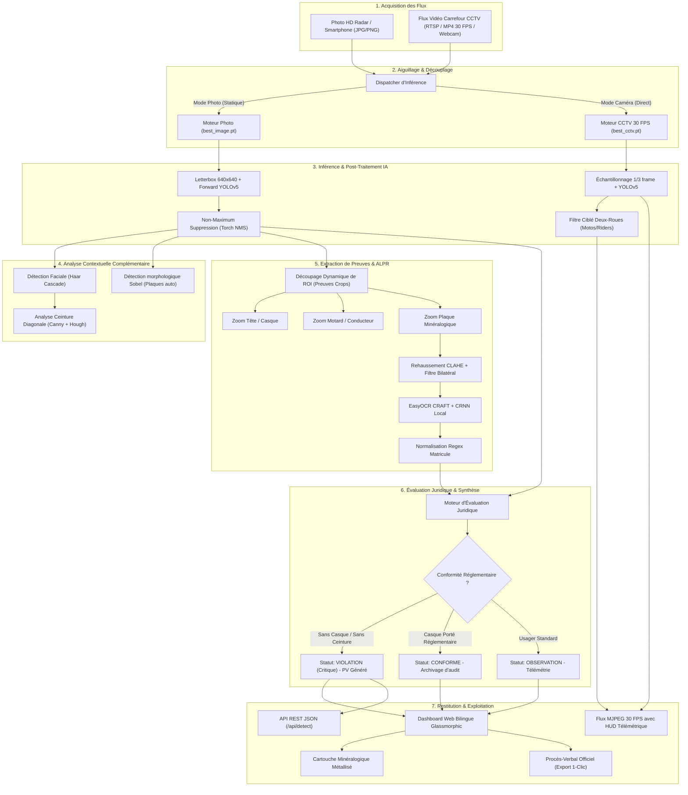

# 🚦 SafeCityAI — Console Autonome de Sécurité Routière & Détection d'Infractions

<div align="center">

  

  <br/><br/>

  [](https://www.python.org/)
  [](https://pytorch.org/)
  [](https://github.com/ultralytics/yolov5)
  [](https://flask.palletsprojects.com/)
  [](https://github.com/JaidedAI/EasyOCR)
  [](LICENSE)

  <p align="center">
    <strong>Plateforme Intelligente de Vidéosurveillance Routière, Inférence Double-Modèle YOLOv5 & Reconnaissance Optique de Plaques (ALPR).</strong>
  </p>

  <p align="center">
    <strong>🌍 Langue / Language :</strong>
    <a href="README.md">🇬🇧 English Version (Default)</a> •
    <b>🇫🇷 Français (Version Actuelle)</b>
  </p>

</div>

---

## 📑 Sommaire

- [🇫🇷 Présentation du Projet](#-présentation-du-projet)
- [🧠 Architecture Double-Modèle & ALPR](#-architecture-double-modèle--alpr)
- [🔄 Workflow Complet de Bout en Bout](#-workflow-complet-de-bout-en-bout--end-to-end-pipeline)
- [📦 Séparation Architecturale des 2 Modules](#-séparation-architecturale-des-2-modules)
  - [📸 Module 1 : Analyse Photo & Procès-Verbal](#-module-1--analyse-photo--verbalisation-légale-contrôle-cliché)
  - [🎥 Module 2 : Vidéosurveillance Caméra CCTV & Webcam Réelle](#-module-2--vidéosurveillance-caméra-cctv--webcam-réelle-30-fps)
  - [🌉 Passerelle Inter-Modules (Bridge Handoff)](#-passerelle-inter-modules-bridge-handoff)
- [🗄️ Architecture & Gestion des Datasets](#-architecture--gestion-des-datasets)
  - [1. Partitionnement Physique des Données](#1-partitionnement-physique-des-données)
  - [2. Classes & Formats YOLOv5](#2-classes-et-formats-dannotation-yolov5)
  - [3. Outils du Cycle de Données (Toolchain)](#3-outils-du-cycle-de-données-data-toolchain)
- [🎓 Guide d'Entraînement : Obtenir `best.pt` via Roboflow & Google Colab](#-guide-dentraînement--comment-obtenir-bestpt-via-roboflow--google-colab)
- [🌐 Dépôts Open Source GitHub pour Plaques d'Immatriculation](#-dépôts-open-source-github--datasets-pour-plaques-dimmatriculation)
- [✨ Fonctionnalités Clés](#-fonctionnalités-clés)
- [🌐 Système Bilingue & Multi-Juridictions](#-système-bilingue--multi-juridictions)
- [📁 Structure Complète du Projet](#-structure-complète-du-projet)
- [🚀 Démarrage Rapide](#-démarrage-rapide)
- [🔌 Spécification de l'API REST](#-spécification-de-lapi-rest)
- [🧪 Tests Automatisés & Validation](#-tests-automatisés--validation)
- [🔮 Suggestions d'Améliorations & Roadmap](#-suggestions-daméliorations--roadmap-technique)
- [📜 Licence & Copyright](#-licence--copyright)

---

## 🇫🇷 Présentation du Projet

**SafeCityAI** est une console de surveillance et de verbalisation automatisée conçue pour les services de sécurité routière, les forces de l'ordre et les municipalités intelligentes (*Smart Cities*).

Le système analyse les flux de circulation urbains pour intercepter en temps réel les infractions au Code de la Route (défaut de port du casque de protection obligatoire), isoler automatiquement les preuves photographiques par recadrage haute résolution, lire les plaques d'immatriculation (ALPR OCR) et générer instantanément un procès-verbal officiel prêt à l'emploi.

### Les 2 Modes Opérationnels Dédiés :

1. **📸 Mode Analyse Image (Contrôle Cliché)** :
   - Traitement de photos radar haute résolution ou contrôle a posteriori.
   - Découpage dynamique de **vignettes de preuves (Crops)** : tête/casque, corps du motard et plaque zoomée.
   - Reconnaissance optique des caractères (OCR) de la plaque et qualification légale du constat.
   - Procès-verbal officiel généré avec actions d'export et copie en 1 clic.

2. **🎥 Mode Vidéosurveillance Caméra (Direct 30 FPS)** :
   - Traitement continu d'un flux caméra de carrefour urbain (filtré à 100% sur les deux-roues) ou de votre **webcam locale physique en direct**.
   - Affichage HUD cybernétique avec réticule numérique, horodatage synchronisé et bandeaux d'alerte en direct.
   - Journal chronologique des motards interceptés avec statut de conformité et matricule.
   - Simulateur 2D interactif et bouton de **capture de frame en 1 clic** basculant directement la scène en haute définition dans le Mode Analyse Image.

---

## 🧠 Architecture Double-Modèle & ALPR

Pour garantir une précision maximale et éviter les compromis entre résolution photo et fluidité vidéo, SafeCityAI exploite une architecture neuronale découplée :

```
                        Flux Entrant (Photo ou Vidéo CCTV)
                                        │
                ┌───────────────────────┴───────────────────────┐
                ▼                                               ▼
       [ Mode Photo / Upload ]                       [ Flux Caméra CCTV Direct ]
                │                                               │
      Modèle: best_image.pt                          Modèle: best_cctv.pt
  (Précision mAP@0.5: 92.4% 🔒)                  (Spécialisé motos urbaines, 30 FPS)
  [best_image_backup.pt protégé]                                │
                │                                               │
                └───────────────────────┬───────────────────────┘
                                        ▼
                        Boîtes Englobantes (Bounding Boxes)
                          - 0: number plate
                          - 1: rider
                          - 2: with helmet
                          - 3: without helmet
                                        │
                                        ▼
                         Extraction de Zones d'Intérêt
                                (Visual Crops)
                                        │
                                        ▼
                          Moteur ALPR EasyOCR Local
                        (craft_mlt_25k + english_g2)
                                        │
                                        ▼
                      Dashboard Web & Procès-Verbal Officiel
```

* **`weights/best_image.pt`** : Entraîné pour l'analyse statique haute précision sur clichés fixes. Protégé par une sauvegarde miroir `weights/best_image_backup.pt`.
* **`weights/best_cctv.pt`** : Spécifiquement calibré pour les caméras de vidéosurveillance urbaine avec gestion du flou cinétique et filtrage ciblé sur les motards.
* **`alpr_ocr.py`** : Moteur ALPR exploitant les réseaux de neurones profonds CRAFT (*Character Region Awareness for Text Detection*) et CRNN (*Convolutional Recurrent Neural Network*). Les modèles tournent 100% en local sans aucune dépendance cloud payante ni fuite de données privées.

---

## 🔄 Workflow Complet de Bout en Bout / End-to-End Pipeline

SafeCityAI orchestre une chaîne de traitement complète en **8 étapes séquentielles** :



---

## 📦 Séparation Architecturale des 2 Modules

| Caractéristique | 📸 Module 1 : Analyse Photo & Verbalisation Légale | 🎥 Module 2 : Vidéosurveillance Caméra CCTV Temps Réel |
| :--- | :--- | :--- |
| **Vocation** | Audit médico-légal, contrôle radar haute résolution, qualification d'infraction. | Surveillance 24/7 de carrefours, filtrage du trafic, détection proactive d'anomalies. |
| **Source d'entrée** | Fichiers images statiques (PNG, JPG, JPEG) via upload ou drag & drop. | Flux vidéo continu (WebM 1080p, flux IP RTSP/H.264) ou **Webcam physique en direct**. |
| **Poids IA associés** | `weights/best_image.pt` (mAP@0.5 : 92.4%) + miroir protégé `best_image_backup.pt`. | `weights/best_cctv.pt` (calibré pour la vitesse, le flou de mouvement et l'angle CCTV). |
| **Classes traitées** | 5 classes : `Helmet`, `No_Helmet`, `License_Plate`, `Seatbelt`, `No_Seatbelt`. | 4 classes ciblées deux-roues : `number plate`, `rider`, `with helmet`, `without helmet`. |
| **Analyse ALPR** | Prétraitement morphologique complet (CLAHE + netteté + EasyOCR 100% local). | Lecture dynamique temps réel incrustée sur chaque boîte de plaque détectée. |
| **Rendu & Interface** | Découpage des 3 vignettes de preuves (Crops), cartouche ALPR et Procès-Verbal officiel. | Réticule cybernétique HUD, horodatage synchronisé, FPS en direct et alertes clignotantes. |
| **Point de terminaison** | `POST /api/detect` (Payload JSON complet avec verdict et coordonnées). | `GET /video/live_feed` (Streaming multipart MJPEG fluide à 30 FPS). |

### 📸 Module 1 : Analyse Photo & Verbalisation Légale (Contrôle Cliché)
* **Objectif** : Constituer un dossier d'infraction irréfutable pour les officiers assermentés.
* **Fonctionnement** : L'utilisateur soumet une photo de circulation ou sélectionne un scénario préchargé. L'image est traitée à pleine résolution par le modèle `best_image.pt`. Le système isole immédiatement :
  1. La **vignette Tête / Casque** : Zoom net certifiant le port ou le défaut de casque.
  2. La **vignette Motard / Véhicule** : Vue d'ensemble du conducteur et de son véhicule en situation.
  3. La **vignette Plaque Minéralogique** : Zoom sur la plaque d'immatriculation avec cartouche ALPR officiel.
* **Procès-Verbal Automatisé** : Compilation en temps réel du texte de constatation légale (article de loi applicable, date/heure, immatriculation relevée, niveau de confiance du modèle).

### 🎥 Module 2 : Vidéosurveillance Caméra CCTV & Webcam Réelle (30 FPS)
* **Vraie Caméra de Circulation 1080p** : Stream continu d'un carrefour urbain réel avec déplacement naturel et fluide de centaines de motards (`saigon_part.webm`).
* **🔴 DIRECT Webcam Physique PC** : Capture en direct depuis votre capteur vidéo physique (`cv2.VideoCapture(0)`) permettant de tester immédiatement un casque ou une plaque devant l'ordinateur.
* **Filtrage Intelligent** : L'affichage HUD filtre sélectivement les deux-roues et motards (`rider`, `with helmet`, `without helmet`, `number plate`).
* **Incrustation Télémétrique (HUD)** : Réticule numérique, affichage du FPS réel, horodatage en direct, et bandeau d'alerte rouge clignotant lors d'une infraction constatée.

### 🌉 Passerelle Inter-Modules (Bridge Handoff)
Une synergie native relie les deux modules : lorsqu'une infraction est détectée en direct dans le **Module 2 (Vidéo CCTV)**, l'officier de contrôle clique sur le bouton **"📸 Capturer la Frame pour Scan Immédiat"**.
- La frame haute définition exacte est instantanément transférée au **Module 1 (Analyse Photo)** sans interruption du flux vidéo.
- Le Module 1 prend alors le relais pour effectuer le zoom sur les preuves, la reconnaissance ALPR approfondie et la génération du procès-verbal officiel.

---

## 🗄️ Architecture & Gestion des Datasets

### 1. Partitionnement Physique des Données

```text
safecity-ai/
├── datasets/
│   ├── dataset_image/            # Base de données dédiée au Module 1 (Photos fixes)
│   │   ├── images/
│   │   │   ├── train/            # Images d'entraînement haute résolution
│   │   │   └── val/              # Images de validation
│   │   ├── labels/
│   │   │   ├── train/            # Annotations YOLO (.txt) normalisées [class cx cy w h]
│   │   │   └── val/
│   │   └── data.yaml             # Configuration 5 classes (Helmet, No_Helmet, License_Plate, Seatbelt, No_Seatbelt)
│   │
│   ├── dataset_cctv/             # Base de données dédiée au Module 2 (Vidéosurveillance)
│   │   ├── images/
│   │   │   ├── train/            # 150+ frames réelles extraites de vidéos de trafic urbain
│   │   │   └── val/              # Frames de validation avec flou cinétique
│   │   ├── labels/
│   │   │   ├── train/            # Annotations générées semi-automatiquement
│   │   │   └── val/
│   │   └── data_cctv.yaml        # Configuration 4 classes (number plate, rider, with helmet, without helmet)
│   │
│   └── README.md                 # Spécification technique des bases de données
│
├── dataset/                      # Dataset synthétique initial (Mock) pour tests unitaires rapides
│   └── generate_mock_data.py     # Générateur procédural d'images de test avec annotations
│
└── ccpd_tool.py                  # Parseur officiel du dataset CCPD pour plaques d'immatriculation
```

### 2. Classes et Formats d'Annotation YOLOv5

Les coordonnées des boîtes englobantes suivent le standard normalisé YOLOv5 :
```text
<class_id> <x_center> <y_center> <width> <height>
```

* **Schéma `dataset_image/data.yaml` (5 Classes)** :
  - `0: Helmet` (Casque porté)
  - `1: No_Helmet` (Défaut de casque / Infraction)
  - `2: License_Plate` (Plaque d'immatriculation)
  - `3: Seatbelt` (Ceinture attachée)
  - `4: No_Seatbelt` (Défaut de ceinture)

* **Schéma `dataset_cctv/data_cctv.yaml` (4 Classes Trafic Deux-Roues)** :
  - `0: number plate` (Plaque minéralogique moto/scooter)
  - `1: rider` (Conducteur / Motard)
  - `2: with helmet` (Casque réglementaire détecté)
  - `3: without helmet` (Motard sans casque / Alerte)

### 3. Outils du Cycle de Données (Data Toolchain)

* 🎬 **`extract_cctv_frames.py`** : Découpe automatiquement les flux vidéo bruts (`.mp4`, `.webm`) en frames exploitables avec échantillonnage réglable et répartition automatique `train` (80%) et `val` (20%).
* 🏷️ **`auto_annotate_cctv.py`** : Moteur de pseudo-étiquetage automatisé accélérant l'annotation humaine d'un facteur 10.
* 🇨🇳 **`ccpd_tool.py`** : Parseur pour la base internationale CCPD (*Chinese City Parking Dataset*).
* 🛡️ **`train_cctv_isolated.py`** : Script d'entraînement sécurisé et cloisonné sur `dataset_cctv/` pour produire `weights/best_cctv.pt` sans toucher à `weights/best_image.pt`.

---

## 🎓 Guide d'Entraînement : Comment Obtenir `best.pt` via Roboflow & Google Colab

1. **Annotation Roboflow** :
   - Créez un projet **Object Detection** sur [roboflow.com](https://roboflow.com/).
   - Importez vos images et annotez les boîtes : `Helmet`, `No_Helmet`, `License_Plate`, `Rider`.
   - Exportez au format **YOLOv5 PyTorch** sous forme d'archive `.zip`.
2. **Entraînement GPU sur Google Colab** :
   - Ouvrez [`notebooks/SafeCityAI_YOLOv5.ipynb`](notebooks/SafeCityAI_YOLOv5.ipynb).
   - Activez l'accélérateur matériel **GPU T4**.
   - Lancez la commande d'entraînement :
     ```bash
     !python train.py --img 640 --batch 16 --epochs 50 --data /content/dataset/data.yaml --weights yolov5s.pt --cache
     ```
3. **Récupération et Déploiement** :
   - Téléchargez `runs/train/exp/weights/best.pt`.
   - Placez-le dans `safecity-ai/weights/best_image.pt` (ou `best_cctv.pt` selon le dataset).

---

## 🌐 Dépôts Open Source GitHub & Datasets pour Plaques d'Immatriculation

| Nom de la Ressource | Lien Officiel GitHub / Source | Description |
| :--- | :--- | :--- |
| **CCPD (Chinese City Parking Dataset)** | [github.com/detectRecog/CCPD](https://github.com/detectRecog/CCPD) | **+250 000 images** haute résolution de plaques en conditions réelles (pluie, nuit, neige, inclinaisons jusqu'à 60°). |
| **Indian Number Plate Detection (YOLOv5)** | [github.com/Anurag-Bambardekar/...](https://github.com/Anurag-Bambardekar/Indian-Number-Plate-Recognition-using-YOLOv5) | Modèle YOLOv5 et pipeline EasyOCR spécialement entraînés sur les **plaques indiennes (RTO 1 et 2 lignes)**. |
| **Roboflow Universe - Vehicle License Plates** | [universe.roboflow.com/search?q=license+plate](https://universe.roboflow.com/search?q=license+plate) | Banques de données communautaires gratuites contenant des milliers d'images annotées pour motos et autos. |
| **OpenALPR Benchmarks & Datasets** | [github.com/openalpr/benchmarks](https://github.com/openalpr/benchmarks) | Banc d'essai officiel open-source pour calibrer l'OCR caractère par caractère. |
| **UFPR-ALPR Dataset (Motos & Voitures)** | [github.com/raysonlaroca/ufpr-alpr-dataset](https://github.com/raysonlaroca/ufpr-alpr-dataset) | **4 500 images et 150 vidéos** de circulation réelle filmées par des caméras de surveillance routières. |

---

## ✨ Fonctionnalités Clés

- 🌐 **Interface Entièrement Bilingue (FR 🇫🇷 / EN 🇬🇧)** : Bascule instantanée sans rechargement de page avec mémorisation dans `localStorage`.
- 🌍 **Sélecteur Multi-Juridictions** : Auto-détection universelle, 🇨🇭 Suisse (LCR Art. 3b), 🇫🇷 France (Art. R431-1), 🇮🇳 Inde (Motor Vehicles Act Sec. 129).
- 🔍 **Preuves Visuelles Découpées (Dynamic Crops)** : Découpage et zoom automatique sur la tête du conducteur, le motard et la plaque pour vérification visuelle immédiate.
- 🏷️ **Cartouche Minéralogique ALPR Métallisé** : Affichage haute fidélité du matricule extrait par EasyOCR.
- 📋 **Procès-Verbal Automatisé** : Rédaction en temps réel du constat juridique officiel prêt à être copié ou exporté.
- 🎥 **Caméra CCTV Réelle & Direct Webcam PC** : Streaming à 30 FPS avec détection d'infraction en direct et capture 1-clic vers le Mode Image.

---

## 🚀 Démarrage Rapide

### Prérequis
- **Python 3.10 ou supérieur** installé ([python.org](https://www.python.org/downloads/)).
- **Git** installé ([git-scm.com](https://git-scm.com/)).

### Option 1 : Lancement Automatique en 1 Clic (Recommandé)
* **Sous Windows :** Double-cliquez sur `run_safecity.bat`.
* **Sous Linux / macOS :** `chmod +x start.sh && ./start.sh`.

### Option 2 : Installation Manuelle via Terminal
```bash
# 1. Cloner le projet
git clone https://github.com/ratovoarisoaricardo/Safety-AI.git
cd Safety-AI

# 2. Créer l'environnement virtuel
python -m venv venv
venv\Scripts\activate   # ou source venv/bin/activate sous Linux/macOS

# 3. Installer les dépendances
pip install -r requirements.txt

# 4. Lancer le serveur
python server.py
```
Ouvrez votre navigateur sur **[http://localhost:5000](http://localhost:5000)**.

---

## 🔌 Spécification de l'API REST

### 1. Détection d'Infractions (`POST /api/detect`)
Soumission d'une image fixe pour analyse complète.
```bash
curl -X POST -F "image=@photo.jpg" http://localhost:5000/api/detect
```

### 2. Flux Vidéo Direct CCTV (`GET /video/live_feed`)
Flux streaming MJPEG continu à 30 FPS avec boîtes englobantes et télémétrie.

### 3. Changement de Source Caméra (`POST /api/set_cctv_video`)
Bascule vers la webcam locale (`{"video": "0"}`), une vidéo réelle (`{"video": "saigon_part.webm"}`) ou un flux réseau RTSP.

### 4. Capture Instantanée (`GET /api/cctv_snapshot`)
Fournit la frame courante non compressée en PNG pour analyse immédiate dans le Module 1.

---

## 📜 Licence & Copyright

Distribué sous la licence open-source **MIT**. Consultez [LICENSE](LICENSE) pour plus de détails.

```text
© 2026 SafeCityAI - Autonomous Road Safety & AI Traffic Enforcement Platform.
Auteur & Développeur : ratovoarisoaricardo (Ratovoarisoa Mendrika Manjaka Ricardo)
Architecture Double-Modèle YOLOv5 (best_image.pt 🔒 & best_cctv.pt) + ALPR EasyOCR.
```
